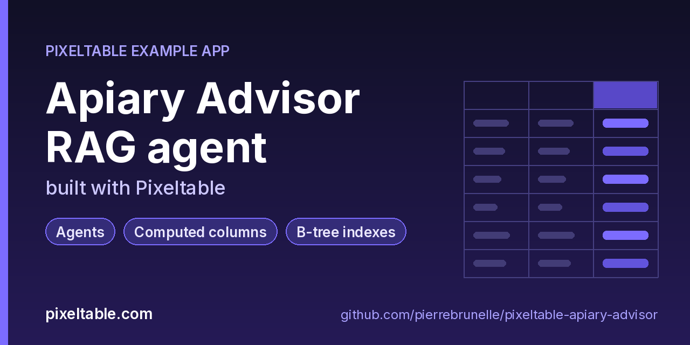

<!-- pixeltable-example-app: 20261013-apiary-advisor -->
# Apiary Advisor RAG agent built with Pixeltable



[](https://codespaces.new/pierrebrunelle/pixeltable-apiary-advisor?quickstart=1)
[](https://pixeltable.com)
[](https://pypi.org/project/pixeltable/)
[](https://github.com/pixeltable/pixeltable)
[](LICENSE)

A small retrieval-augmented agent for hive management. Beekeeping guides are split into sentences by a string_splitter view and indexed with an EmbeddingIndex whose embedding is a custom batched UDF (feature hashing, no model download). A @pxt.query retrieves the best chunks. The Advisor table is an agent pipeline (retrieve, format context, draft an answer) that run.py turns into a reusable function with pxt.udf(table, return_value=...) and applies to hive inspections. Mite load is an expr_udf, varroa_action is both a computed column and an LLM tool, functions.net.presigned_url turns object-storage sources into links, and a pxt.ConfigVar reads the apiary region from pixeltable.toml. Drive it with `python run.py`; no HTTP router.

[Pixeltable](https://pixeltable.com) is open-source, Python-native **multimodal AI data infrastructure**: tables, incremental computed columns, UDFs, indexes and serving in one library, running locally or on Pixeltable Cloud.

> ⭐ **Like this example?** Star [pixeltable/pixeltable](https://github.com/pixeltable/pixeltable) on GitHub. It helps other developers find it.

## What this example shows

- **Incremental computed columns** powered by plain Python UDFs (`@pxt.udf`)
- **B-tree indexes** declared on the model (`__indexes__`) back the lookup queries
- **Secrets** set with `pxt secret set` and read at runtime, never hard-coded
- **Agents and tool calling**: Pixeltable functions exposed as LLM tools
- **Importable UDF module**: UDFs live in `udfs.py`; tables and queries live in `app.py` (Pixeltable resolves UDFs by module path)
- **`pixeltable.toml`** declares a local database and a **Pixeltable Cloud** database, so the same code deploys with `pxt db update`

## Custom embedding index

`udfs.hash_embed` is a `@pxt.udf(batch_size=16)` over `Batch[str]` returning `pxt.Array[(256,), pxt.Float]`. `GuideChunks` declares `pxt.EmbeddingIndex(text, string_embed=hash_embed, metric='cosine')`, and `search_guides` orders by `text.similarity(string=...)`. Swap in any real embedding model with the same signature.

## A table as a function

`Advisor` is an agent table: `question -> hits -> context -> answer`, all computed columns. `run.py` wraps it with `pxt.udf(advisor, return_value=advisor.answer)` and calls it from a query over `Inspections` (`advise(question=insp.note)`). Without `return_value` the function returns a dict of every pipeline column. The function inlines the pipeline's expressions; it does not write rows into the Advisor table. A table model class is not a `Table`, so the wrapping happens on the live table from `pxt.get_table`, after `pxt schema update` has created it.

## expr_udf

`mite_load_pct` is a `@pxt.expr_udf`: an expression template (`mites * 100.0 / bees_sampled`) inlined into the plan instead of a Python call.

## Tool calling

`TOOLS = pxt.tools(varroa_action, search_guides)` mixes a UDF and a `@pxt.query`. `Questions` calls `openai.chat_completions(..., tools=TOOLS)`, runs the chosen tools with `openai.invoke_tools`, then asks once more for a short final answer. Keep the two calls' `model_kwargs` dicts different: `chat_completions` adds `tools` to the dict it receives.

## Config vars

`APIARY_REGION = pxt.ConfigVar('apiary_region', str)` is read inside `udfs.with_region` with `.value()`. The value comes from `vars.apiary_region` in `pixeltable.toml`, and the `PIXELTABLE_VAR_APIARY_REGION` environment variable overrides it (`pxt config --section pixeltable.database.vars` shows which source won).

## Presigned links

`guides_by_topic` selects `pxtf.net.presigned_url(source_uri, 3600)`: `s3://` URIs become HTTPS links, `https://` links pass through, nulls stay null, and local `file://` paths are rejected.

## What's inside

| File | What it is |
|------|------------|
| `.devcontainer/devcontainer.json` | GitHub Codespaces / Dev Container config: Python 3.12, installs `requirements.txt` |
| `.github/social-preview.png` | Social preview image (1280x640) |
| `CITATION.cff` | Citation metadata (authors, license, release date, keywords) |
| `app.py` | Tables declared as Python classes and `@pxt.query` functions |
| `data/guides.json` | Sample data |
| `data/inspections.json` | Sample data |
| `pixeltable.toml` | Project config: the local database plus a Pixeltable Cloud database (sizing, deploy excludes) |
| `run.py` | Apiary Advisor driver (rag-agent shape, no HTTP router) |
| `udfs.py` | Pixeltable UDFs (`@pxt.udf`) in their own importable module, imported by `app.py` |
| `requirements.txt` / `pyproject.toml` | Dependencies (`pixeltable>=0.7.16`) |

**Tables**

| Table | Stored columns | Computed columns |
|-------|---------|------------------|
| `guides` | `guide_id`, `title`, `topic`, `body`, `source_uri` | - |
| `guide_chunks` | - | `n_chars` |
| `advisor` | `question` | `regional_question`, `hits`, `context`, `answer` |
| `inspections` | `hive_id`, `mites`, `bees_sampled`, `note` | `inspection_id`, `mite_pct`, `action` |
| `questions` | `question` | `hits`, `context`, `response`, `tool_output`, `final` |

## Run in your browser (GitHub Codespaces)

[](https://codespaces.new/pierrebrunelle/pixeltable-apiary-advisor?quickstart=1)

1. Click **Open in GitHub Codespaces** above (or [this link](https://codespaces.new/pierrebrunelle/pixeltable-apiary-advisor?quickstart=1)). The dev container installs Python 3.12 and `pixeltable>=0.7.16` from `requirements.txt`.
2. In the codespace terminal, create the tables, seed them and run the app:

   ```bash
   pxt schema update app.py apiary
   pxt schema update app.py apiary
   export OPENAI_API_KEY=...   # optional: enables the tool-calling Questions table (gpt-4o-mini, 2 rows)
   python run.py
   ```


## Quickstart

Requires Python 3.11+ and `pixeltable>=0.7.16`.

```bash
git clone https://github.com/pierrebrunelle/pixeltable-apiary-advisor.git
cd pixeltable-apiary-advisor
python -m venv .venv && source .venv/bin/activate
pip install -r requirements.txt

# Create the tables in a local catalog directory named `apiary`
pxt schema update app.py apiary

pxt schema update app.py apiary
export OPENAI_API_KEY=...   # optional: enables the tool-calling Questions table (gpt-4o-mini, 2 rows)
python run.py
```

## Deploy to Pixeltable Cloud

The same `app.py` runs on [Pixeltable Cloud](https://pixeltable.com). Sign in (or get a free trial database with `pxt new`), point the second database entry in `pixeltable.toml` at your own database, then deploy:

```bash
pxt login                       # or: export PIXELTABLE_API_KEY=<your-api-key>
# edit pixeltable.toml: name = 'pxt://<your-org>:<your-db>'
pxt db update pxt://<your-org>:<your-db>                 # build the image and upload the project
pxt schema update app.py pxt://<your-org>:<your-db>       # create the tables at the database root (no per-app folder)
```

Keep keys in environment variables or `pxt secret set`, never in code.

## Code walkthrough

**1. Business logic is plain Python, in `udfs.py`.** A `@pxt.udf` function can be used as a column expression. Pixeltable records UDFs by module path (`udfs.hash_embed`), so they live in their own importable module rather than inline in the app: the daemon, serving workers and Pixeltable Cloud import it again by that path.

```python
# udfs.py
@pxt.udf(batch_size=16)
def hash_embed(texts: Batch[str]) -> Batch[pxt.Array[(EMBED_DIM,), pxt.Float]]:
    """Custom embedding UDF for the chunk index (batched, 256-d)."""
    return [_hash_vector(t) for t in texts]
```

**2. Tables are Python classes (`app.py`).** Annotated attributes are stored columns; attributes assigned an expression are **computed columns** (`hits`, `context`, `response`, `tool_output`, `final`), evaluated incrementally on every insert or update and recomputed when their inputs change.

```python
# app.py
class Questions(TableModel, name='questions', has_default_idxs=False):
    """Beekeeper questions answered by an LLM that may call varroa_action / search_guides."""

    question: pxt.String
    hits = search_guides(question, 3)
    context = format_context(hits)
    response = openai.chat_completions(
        advisor_messages(question, context),
        model='gpt-4o-mini',
        model_kwargs={'max_tokens': 160, 'temperature': 0},
        tools=TOOLS,
    )
    tool_output = openai.invoke_tools(TOOLS, response)
    # Keep this model_kwargs literal different from the tool-calling one above: chat_completions
    # adds `tools` to the dict it is given, and equal literals can end up shared between columns.
    final = openai.chat_completions(
        final_messages(question, context, tool_output),
        model='gpt-4o-mini',
        model_kwargs={'max_tokens': 200, 'temperature': 0},
    )
    answer = final.choices[0].message.content
```

**3. Queries are functions (`app.py`).** `@pxt.query` wraps a Pixeltable query so it can be called from Python or exposed as a route:

```python
# app.py
@pxt.query
def search_guides(question: str, k: int = 3):
    """Top-k guide sentences for a question (custom-embedding similarity)."""
    sim = GuideChunks.text.similarity(string=question, idx='chunk_embed')
    return (
        GuideChunks.order_by(sim, asc=False)
        .limit(k)
        .select(GuideChunks.guide_id, GuideChunks.title, GuideChunks.text, score=sim)
    )
```

## Learn more

- 🌐 Website: https://pixeltable.com
- 📚 Docs: https://docs.pixeltable.com
- 💻 Source: https://github.com/pixeltable/pixeltable (⭐ star it if Pixeltable is useful to you)
- 📦 PyPI: https://pypi.org/project/pixeltable/
- 🧩 More example apps: https://pierrebrunelle.github.io/awesome-pixeltable-apps/

**[More Pixeltable example apps →](https://pierrebrunelle.github.io/awesome-pixeltable-apps/)**

---

<sub>Built as part of a daily series of Pixeltable example apps · Pixeltable 0.7.16 · Python, incremental computed columns · Licensed under Apache-2.0.</sub>
